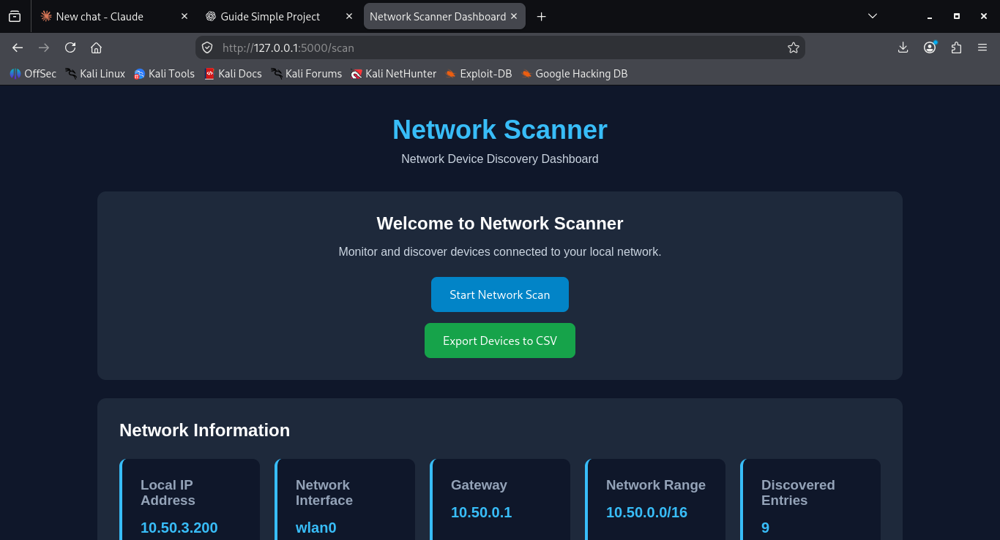
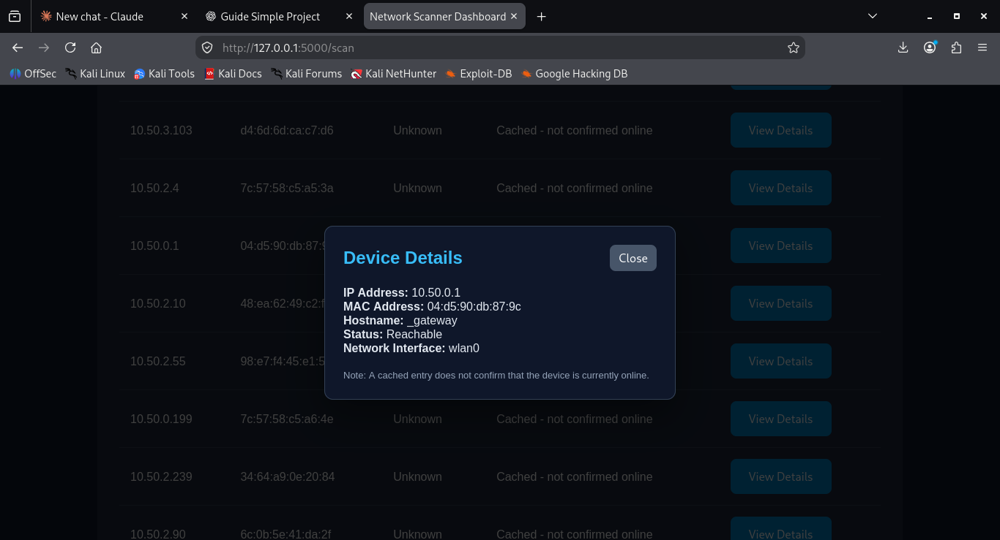

# Network Scanner and Device Discovery Tool

## 1. Project Overview

The Network Scanner and Device Discovery Tool is a Python-based web application that displays network information and identifies device entries visible on the computer's local network.

The application uses Flask to provide a simple dashboard where users can view network details, inspect discovered entries, filter results, and export device information as a CSV file.

## 2. Project Objectives

- Display the computer's local IP address.
- Identify the active network interface.
- Display the default network gateway.
- Identify the local network range.
- Read and display device entries from the Linux network neighbour table.
- Allow users to search and filter displayed entries.
- Provide detailed information about individual entries.
- Export device information into a CSV file.

## 3. Technologies Used

- **Python:** Main programming language.
- **Flask:** Web framework used to build the dashboard.
- **HTML:** Structures the web pages.
- **CSS:** Styles the dashboard.
- **JavaScript:** Supports interactive dashboard features.
- **Chart.js:** Displays device statistics in a doughnut chart.
- **Linux networking commands:** Retrieve local network information and neighbour-table entries.

## 4. Main Features

### Network Information
Displays:
- Local IP address
- Network interface
- Default gateway
- Network range
- Number of discovered entries

### Device Discovery
Reads device information visible in the Linux neighbour table, including IP addresses, MAC addresses, hostnames where available, and neighbour status.

### Search and Filtering
Allows users to search for entries using IP addresses, MAC addresses, or hostnames and filter entries by status.

### Device Statistics
Displays counts of reachable, cached, and other-status entries using statistics cards and a chart.

### Device Details
Provides a details window for viewing information about a selected entry.

### CSV Export
Allows users to download the displayed type of device information in CSV format for further analysis.

## Application Screenshots

### Main Dashboard


### Device Details


### CSV Export


## 6. How the Application Works

1. The user opens the application in a web browser.
2. The Flask application retrieves local network information.
3. When the user selects **Start Network Scan**, the application reads the Linux neighbour table.
4. The retrieved entries are displayed in a dashboard table.
5. The user can search, filter, inspect details, and export the entries as a CSV file.

The scanner uses the Linux command `ip neigh` to read neighbour-table information. It does not actively probe every address in the network range.

## 7. Project Structure

```text
network-scanner/
│
├── app.py
├── scanner.py
├── templates/
│   └── index.html
├── static/
│   └── style.css
├── screenshots/
├── README.md
└── venv/
```

## 8. Installation and Setup

### Requirements
- Linux operating system
- Python 3
- pip
- Visual Studio Code (recommended)

### Steps

1. Clone or download the project.
2. Open the project folder in the terminal.
3. Create a virtual environment:

```bash
python3 -m venv venv
```

4. Activate the virtual environment:

```bash
source venv/bin/activate
```

5. Install Flask:

```bash
pip install flask
```

## 9. Running the Application

From the project directory, run:

```bash
python3 app.py
```

Open a web browser and visit:

```text
http://127.0.0.1:5000
```

Click **Start Network Scan** to retrieve the available neighbour-table entries.

## 10. Limitations

- The application displays entries available in the computer's Linux neighbour table; it does not guarantee discovery of every device connected to the network.
- Some entries may be cached and may not represent devices that are currently online.
- Hostnames may appear as "Unknown" when reverse DNS lookup is unavailable.
- Public Wi-Fi networks may restrict communication between connected devices.
- The statistics depend on the entries returned by the operating system.

## 11. Security and Responsible Use

This tool is intended for learning and authorized network monitoring. Only inspect networks and devices that you own or have permission to monitor.

## 12. Future Improvements

- Add more detailed network diagnostics.
- Improve device identification.
- Add scan history.
- Provide additional report formats.
- Improve dashboard presentation and usability.

## 13. Conclusion

The Network Scanner and Device Discovery Tool demonstrates how Python, Flask, and Linux networking commands can be combined to build a web-based network information dashboard. It provides a simple way to view available network information, inspect neighbour-table entries, and export results for further analysis.v